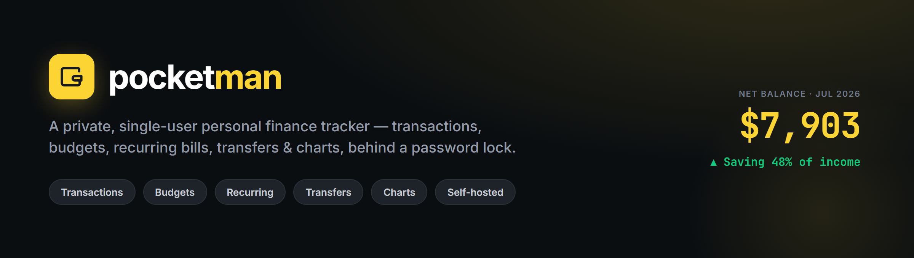
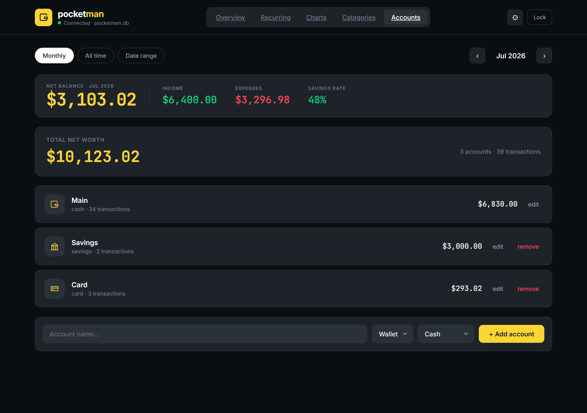
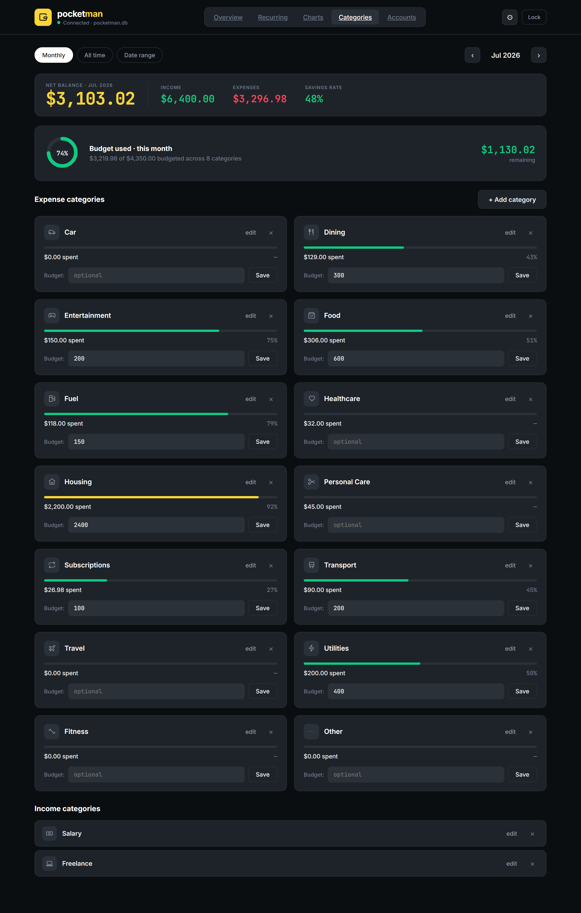
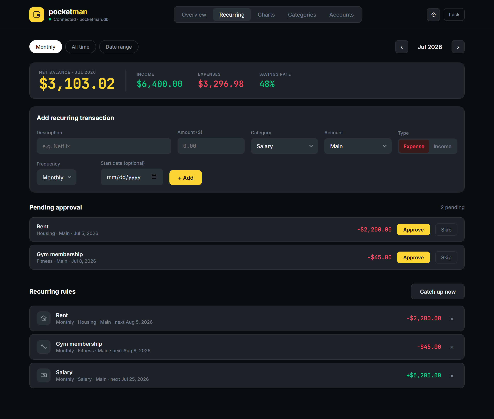
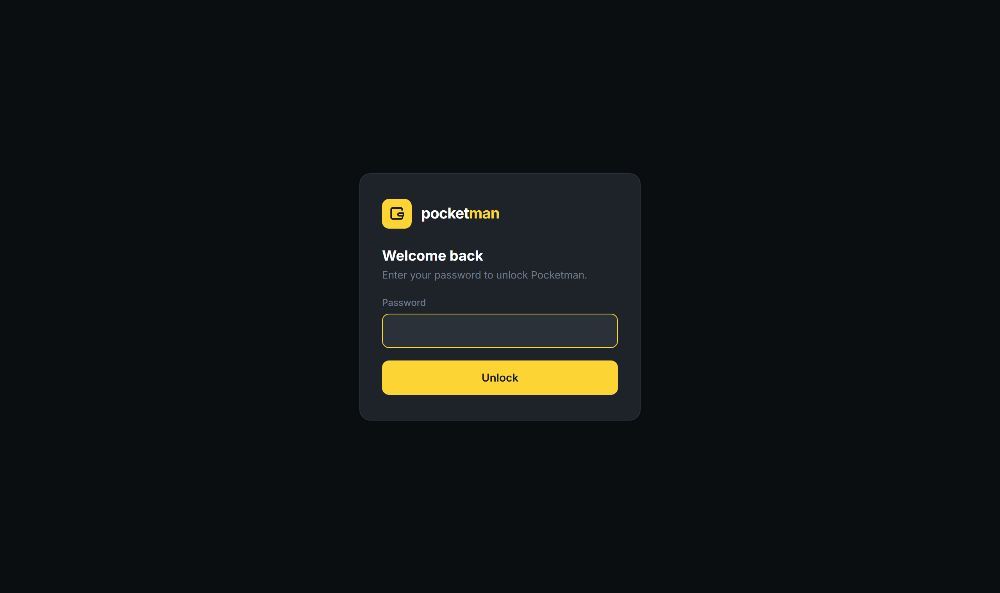

<p align="center">
  
</p>

# Pocketman

A single-user personal finance tracker — transactions, budgets, recurring bills,
accounts, transfers, and charts — behind a password lock. Built from a Claude-generated
UI prototype into a real product: **FastAPI + SQLite** backend, **React + TypeScript**
frontend, packaged with **Docker Compose**.

## Screenshots

**Overview** — add income/expense or transfer between accounts, search, filter, edit, import/export CSV.

<p align="center"></p>

**Charts** — a daily calendar heat-grid plus income-vs-expenses bars, an expenses donut, an all-time cumulative-balance line, and a top-categories ranking.

<p align="center"></p>

<table>
  <tr>
    <td width="50%"><b>Accounts</b><br></td>
    <td width="50%"><b>Categories &amp; budgets</b><br></td>
  </tr>
  <tr>
    <td width="50%"><b>Recurring</b><br></td>
    <td width="50%"><b>Password lock</b><br></td>
  </tr>
</table>

## Features

- **Password lock** — one-time setup, then JWT-authenticated (no accounts, no multi-user).
- **Overview** — add income/expense with category chips **or transfer money between
  accounts** (transfers don't count as income or expense), search + filter, edit/delete,
  and working **CSV export & import** (per-row error reporting on import).
- **Recurring** — rules with real per-rule due-date tracking; "Catch up" generates only
  the occurrences actually due, then you Approve or Skip each pending item.
- **Charts** — a monthly calendar heat-grid of daily income/expense, plus hand-rolled
  SVG: income-vs-expenses bars, expenses-by-category donut, all-time cumulative-balance
  area chart, and a top-categories ranking.
- **Categories** — budget ring, per-category budgets with live progress bars, full CRUD.
- **Accounts** — net worth, per-account balances, inline edit, add/remove.
- **Settings** — accent color (recolors the whole app live), currency symbol,
  show-cents toggle, and change-password.

Money and "today" are real: no demo transactions are seeded (a fresh install starts
empty with just a `Main` account and the default categories), and dates use the real
server clock, not the prototype's hardcoded date.

## Run it

```bash
docker compose -f Setup/docker-compose.yml up --build
# then open http://localhost:3000  (set FRONTEND_PORT in Setup/.env if 3000 is taken)
```

First launch shows a one-time password setup screen. See
[`Setup/README.md`](Setup/README.md) for configuration, local dev (hot reload), and
how to run the tests.

## Layout

| Folder | What |
|---|---|
| [`Backend/`](Backend) | FastAPI + SQLAlchemy + Alembic + SQLite (51 pytest tests) |
| [`Front/`](Front) | React + TypeScript + Vite (32 vitest tests) |
| [`Setup/`](Setup) | `docker-compose.yml`, `.env.example`, run instructions |
| [`AI Instructions/`](AI%20Instructions) | `STRUCTURE.md`, `PLAN.md`, `PROGRESS.md` — the build map |
| [`UI Design/`](UI%20Design) | the original prototype (read-only reference / spec) |

## Tech

Python 3.12 · FastAPI · SQLAlchemy 2 · Alembic · Pydantic v2 · JWT · SQLite ·
React · TypeScript · Vite · React Router · TanStack Query · Axios · bespoke CSS ·
nginx · Docker Compose.

## Tests

```bash
cd Backend && .venv/Scripts/python -m pytest -q     # 51 passed
cd Front   && npm test                              # 32 passed
```
