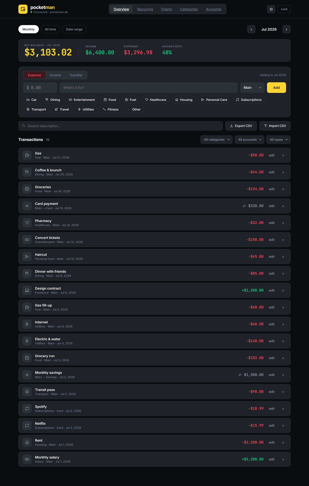
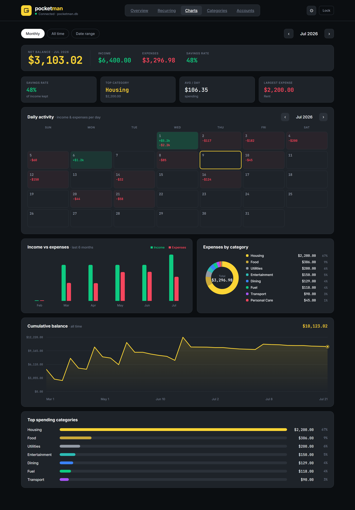
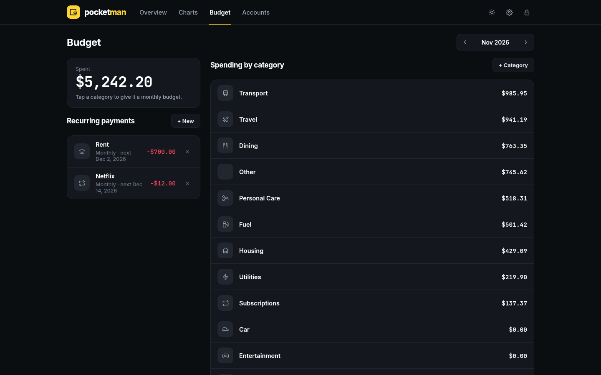
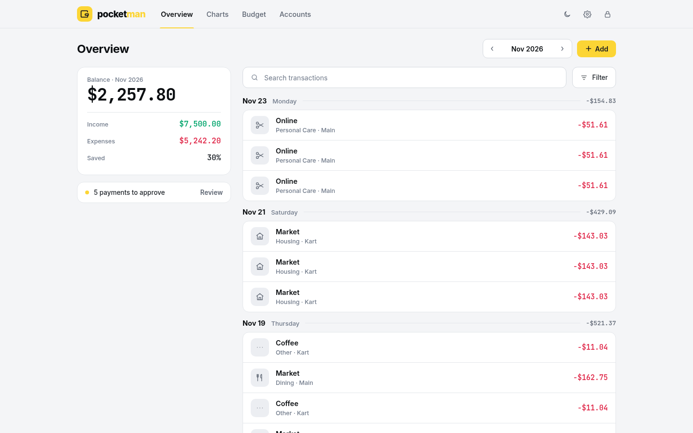
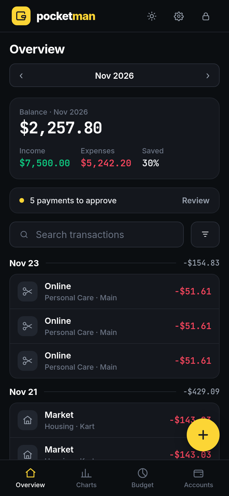

<p align="center">
  
</p>

# Pocketman

A single-user personal finance tracker — transactions, budgets, recurring bills,
accounts, transfers, and charts — behind per-user accounts. Built from a Claude-generated
UI prototype into a real product: **FastAPI + SQLite** backend, **React + TypeScript**
frontend, packaged with **Docker Compose**.

## Screenshots

**Overview** — balance at a glance, recurring payments waiting for approval, and your
transactions. One **+** button opens the add form.

<p align="center"></p>

**Charts** — a stat strip (savings rate, top category, average per day, largest expense)
over a daily calendar heat-grid, income-vs-expenses bars, an expenses donut, and an
all-time cumulative-balance line.

<p align="center"></p>

<table>
  <tr>
    <td width="50%"><b>Budget</b> — spending per category + recurring payments<br></td>
    <td width="50%"><b>Accounts</b> — net worth + balances<br></td>
  </tr>
  <tr>
    <td width="50%"><b>Light mode</b><br></td>
    <td width="50%"><b>On a phone</b> — bottom tab bar<br></td>
  </tr>
</table>

## Features

- **Password lock** — one-time setup, then JWT-authenticated (no accounts, no multi-user).
- **Four sections** — Overview, Charts, Budget, Accounts. On phones they sit in a
  bottom tab bar; Settings, the light/dark switch and Lock are icons in the top bar.
- **Period picker** — on Overview, Charts and Budget: step through months, or switch to
  the last 90 days or all time.
- **Overview** — compact balance/income/expenses summary, search with an optional filter
  row (type, category, account, **tag**), and transactions grouped by day, 50 at a time
  with "Show more". **+** opens the add form (income, expense, or a
  **transfer between accounts**, which doesn't count as income or expense) with your
  most-used categories first, plus an optional **note and tags**. Tap a row to edit or
  delete it. **Budget alerts** appear when a category reaches 80% / 100% of its budget.
- **Recurring payments** — income, expense or **transfer** rules with real per-rule
  due-date tracking. Due items are generated automatically when the app opens and wait on
  Overview for Approve or Skip, or post on their own if the rule is set to
  **Add automatically**. Tap a rule to edit it.
- **Budget** — total spent against your budgets, per-category progress, category
  add/edit (budgets are set there), and the recurring-payment rules.
- **Charts** — a monthly calendar heat-grid of daily income/expense, plus hand-rolled
  SVG: income-vs-expenses bars, expenses-by-category donut, and an all-time
  cumulative-balance area chart. **Monthly report**: a month compared with the one before
  (per-category change, largest expenses, spending by tag), printable / savable as PDF.
- **Accounts** — net worth and every account's balance, with an optional **starting
  balance** for money that was there before Pocketman; add, rename or remove in one form.
  **Savings goals** with progress and how much to put aside per month to hit the date.
- **Installable (PWA)** — "Add to Home Screen" on a phone opens it like an app.
- **Settings** — theme (dark, light, or match the device), accent color, currency
  symbol, show-cents toggle, **CSV export & import** (per-row error reporting on
  import), and change-password.

Money is exact: amounts are stored as whole cents, so totals never drift
(0.10 + 0.20 is 0.30, not 0.30000000000000004). Money and "today" are real: no demo transactions are seeded (a fresh install starts
empty with just a `Main` account and the default categories), and dates use the real
server clock, not the prototype's hardcoded date.

## Run it

```bash
docker compose -f Setup/docker-compose.yml up --build
# then open http://localhost:3000  (set FRONTEND_PORT in Setup/.env if 3000 is taken)
```

To pick up code changes later, run that same command again — `--build` is what
rebuilds the images; your data lives in a volume and survives.

Each person signs up with a username and password; data is private per account.

Other devices on the same network can reach it at `http://<host-ip>:3000` — the port
is published on all interfaces, so no extra config is needed beyond letting it
through the host firewall. See
[`Setup/README.md`](Setup/README.md#access-from-other-devices-on-your-network) for
that, plus configuration, how to update a running stack, local dev (hot reload),
and how to run the tests.

## Layout

| Folder | What |
|---|---|
| [`Backend/`](Backend) | FastAPI + SQLAlchemy + Alembic + SQLite (50 pytest tests) |
| [`Front/`](Front) | React + TypeScript + Vite (36 vitest tests) |
| [`Setup/`](Setup) | `docker-compose.yml`, `.env.example`, run instructions |
| [`AI Instructions/`](AI%20Instructions) | `STRUCTURE.md`, `PLAN.md`, `PROGRESS.md` — the build map |
| [`UI Design/`](UI%20Design) | the original prototype (read-only reference / spec) |

## Tech

Python 3.12 · FastAPI · SQLAlchemy 2 · Alembic · Pydantic v2 · JWT · SQLite ·
React · TypeScript · Vite · React Router · TanStack Query · Axios · bespoke CSS ·
nginx · Docker Compose.

## Tests

```bash
cd Backend && .venv/Scripts/python -m pytest -q     # 112 passed
cd Front   && npm test                              # 58 passed
```
